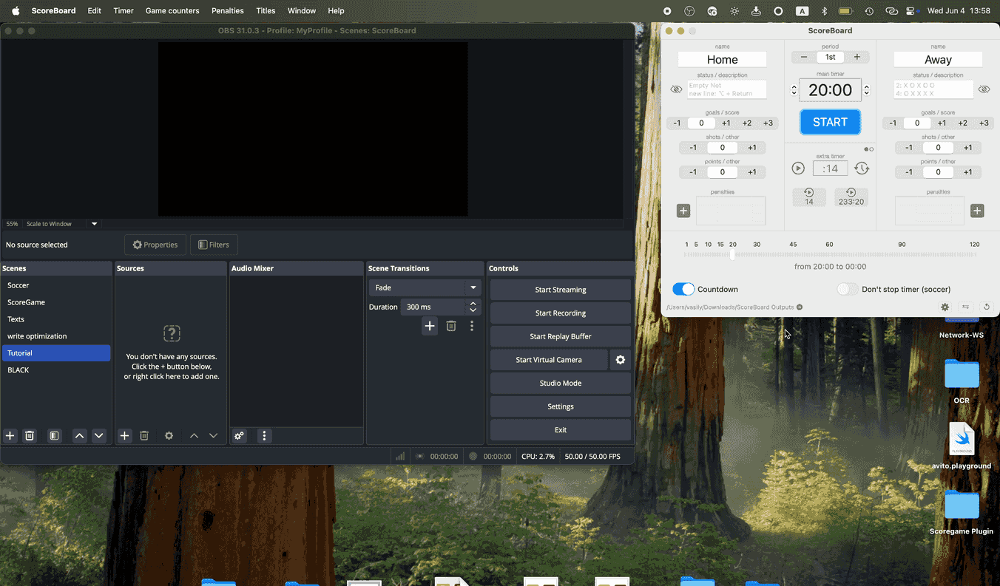
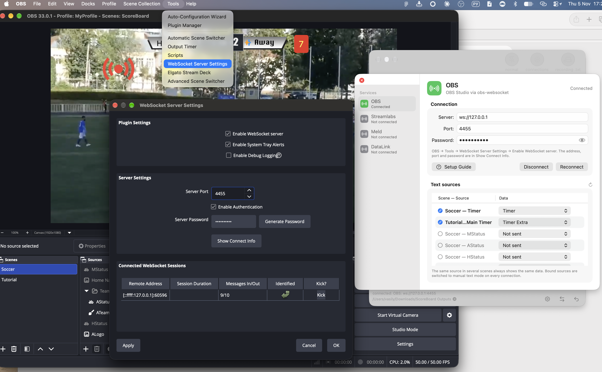
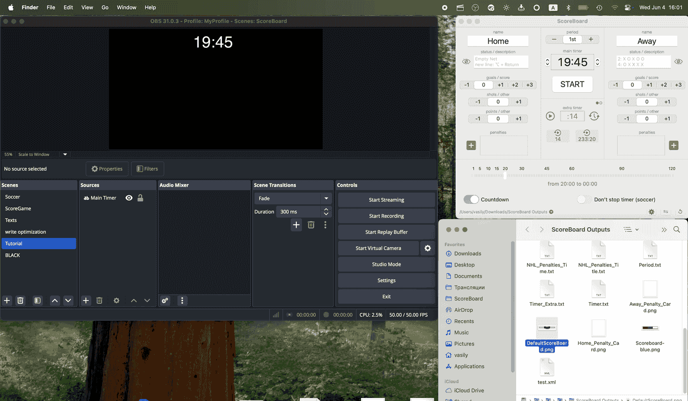
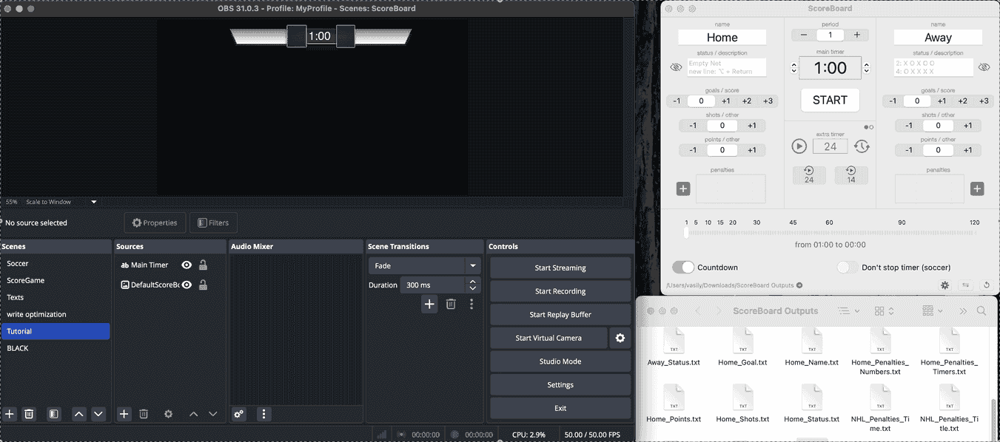
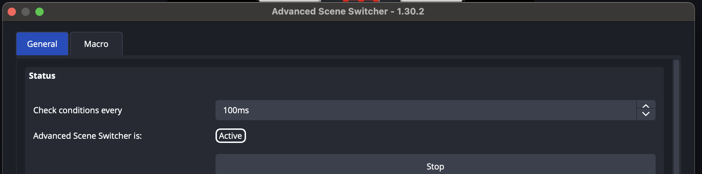
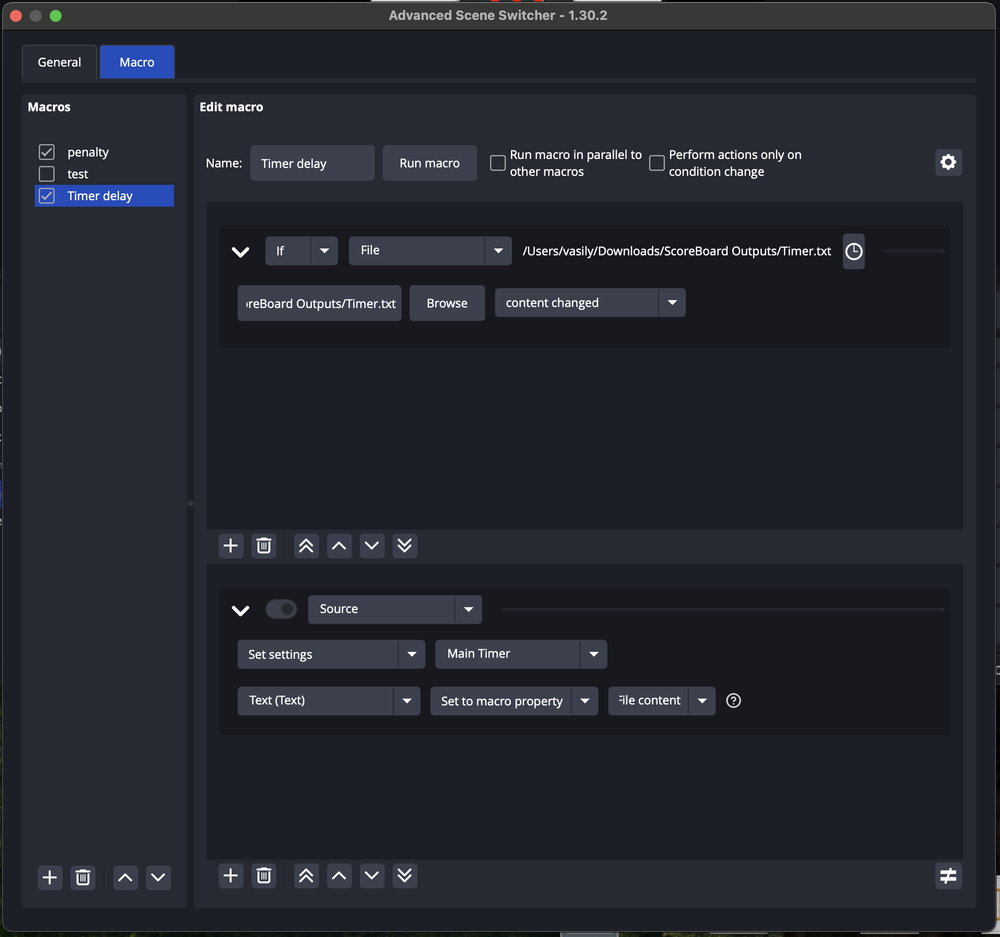
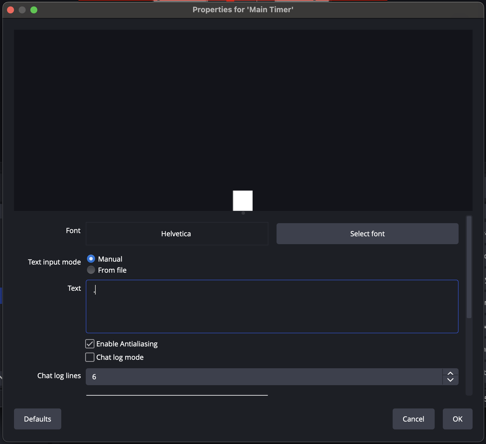
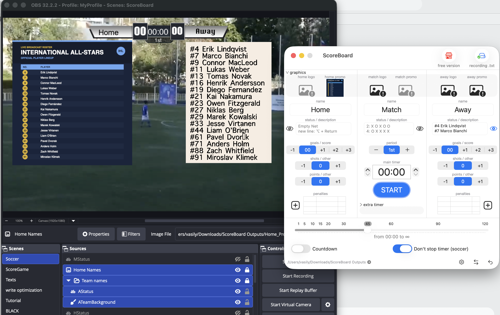

在 OBS 中添加记分牌的教程——同样的 TXT/图像文件来源在 Streamlabs、Wirecast 和 Meld 中的用法完全相同。文本数据还可以通过 WebSocket 即时发送到 OBS、Streamlabs、Meld 和 DataLink（TriCaster）。

_OBS 中的菜单名称按简体中文界面给出，括号内为英文界面名称。_

- [常见问题](#faq)
- [快速入门](#getting-started)
- [输出的文本和图像文件](#output-text-and-image-files)
- [如何在 OBS 中添加计时器/计数器](#how-to-add-a-text-timer-or-counter-in-obs)
- [如何通过 WebSocket 向 OBS 发送文本](#how-to-send-text-to-obs-via-websocket)
- [如何添加记分牌背景](#how-to-add-a-scorebug-background-image-in-obs)
- [如何正确显示十分之一秒](#how-to-display-tenths-of-a-second-in-obs)
- [如何显示球队阵容](#how-to-show-team-rosters-in-an-obs-broadcast)

---

## 常见问题 {#faq}

**如何在 Mac 上为 OBS 添加实时体育记分牌？**  
安装 ScoreBoard for Mac，然后在 OBS 中把它输出的 TXT 文件添加为 *文本 (FreeType 2)* 来源，把宣传图/队徽图片添加为 *图像* 来源——参见下方的[快速入门](#getting-started)。也可以通过 WebSocket 把 ScoreBoard 连接到 OBS，并为每个文本来源选择要显示的数据——参见[如何通过 WebSocket 向 OBS 发送文本](#how-to-send-text-to-obs-via-websocket)。

**为什么 OBS 的文本来源不能即时更新？**  
OBS 默认大约每秒重新读取一次文本文件。若需要即时更新，请通过 WebSocket 把 ScoreBoard 连接到 OBS：每次改动都会直接发送到文本来源，没有读取文件的延迟——参见[如何通过 WebSocket 向 OBS 发送文本](#how-to-send-text-to-obs-via-websocket)。如果继续使用文本文件，需要更快的更新（例如计时器的十分之一秒）时，请使用 Advanced Scene Switcher 插件——参见[如何显示十分之一秒](#how-to-display-tenths-of-a-second-in-obs)。

**TXT 文件和 WebSocket 有什么区别？**  
任何能读取文本文件的直播软件都支持 TXT 文件，但软件会延迟重新读取（OBS 大约每秒一次）。通过 WebSocket，ScoreBoard 会把每次改动即时发送到 OBS、Streamlabs、Meld 或 DataLink（TriCaster），计时器和比分无需额外插件即可无延迟更新。文本文件仍会照常写入，因此两种方式可以同时使用。

**可以在直播中显示球队阵容吗？**  
可以——把阵容以文本形式填入球队的状态字段，和/或通过宣传按钮以图片形式添加，然后在 OBS 中用文本和图像来源显示——参见[如何显示球队阵容](#how-to-show-team-rosters-in-an-obs-broadcast)。

**能否用 Streamlabs、Wirecast 或 Meld 代替 OBS？**  
可以。ScoreBoard 输出的是普通 TXT 文件和图像文件，任何支持文本文件或图像文件来源的直播软件都能像 OBS 一样读取。Streamlabs、Meld 以及 DataLink（TriCaster）还可以通过 WebSocket 即时接收文本数据。

**一定要有记分牌背景图吗？只用文本来源可以吗？**  
两种方式都可以。仅用文本来源即可显示实时数值；在其下方添加背景图（参见[如何添加记分牌背景](#how-to-add-a-scorebug-background-image-in-obs)）能让画面更美观。

---

## 快速入门 {#getting-started}

**macOS 版 OBS 记分牌**是一款易用的应用，面向体育爱好者、解说员和主播，帮助他们在 OBS Studio 场景中显示两支球队或两名选手的实时比分。这款轻量应用简化了记分牌的管理和接入，让你专注于比赛和观众。

**用 macOS 版 OBS 记分牌提升你的体育直播——简单、高效、专为直播打造！**

## 适用场景 {#ideal-use-cases}

- 体育赛事（足球、篮球、排球等）  
- 电竞和游戏比赛  
- 实况解说和分析直播  

## 功能 {#features}

- **实时更新比分：**比赛过程中可随时轻松更新比分。  
- **文本文件集成：**自动生成并更新包含记分牌信息的 `.txt` 文件，兼容 OBS Studio 的 *文本 (FreeType 2)* 来源。  
- **WebSocket 集成：**把文本数据即时发送到 OBS Studio、Streamlabs、Meld 和 DataLink（TriCaster），没有读取文件的延迟。
- **资源占用极低：**应用针对 macOS 优化，即使在配置较低的电脑上也能流畅运行。  
- **直观的界面：**简洁清晰的界面，便于管理球队、比分及其他比赛信息。
- **可自定义布局：**可按直播风格调整记分牌外观，包括字号、颜色和位置。这些设置在直播软件中完成，例如 OBS。  

## 使用流程 {#how-it-works}

1. **安装应用**  
   - 在电脑上安装 ScoreBoard for Mac：  
      - [在 Mac App Store 购买](https://apps.apple.com/app/id1579159150)  
      - [下载免费版](/free-apps/ScoreBoard-free.zip)并解压——已通过 Apple 公证，可放心使用  
   - 打开应用，设置球队/选手名称和其他初始设置。  

2. **实时更新比分**  
   - 使用应用中简单易用的控件调整双方比分。  
   - 应用会自动把更新后的数据保存到 `.txt` 文件。默认目录为 `下载/ScoreBoard Outputs`。
   - WebSocket 连接处于活动状态时，同样的数据会即时发送到 OBS、Streamlabs、Meld 或 DataLink（TriCaster）。

3. **接入 OBS Studio**  
   - 在 OBS 中新建 *文本 (FreeType 2)* 来源，或直接把所需的文本文件拖入 OBS 窗口。  
   - 勾选“从文件读取”（*Read from File*），并选择应用生成的 `.txt` 文件。  
   - 在 OBS 中调整文本来源：位置、大小、字体、颜色等。  
   - 或者通过 WebSocket 把 ScoreBoard 连接到 OBS，并把文本来源绑定到数据——参见[如何通过 WebSocket 向 OBS 发送文本](#how-to-send-text-to-obs-via-websocket)。

4. **直播或录制**  
   - 你在 ScoreBoard 中更新比分时，变化会实时反映到 OBS 中。OBS 会自动从磁盘读取文件（大约每秒一次）并显示结果。通过 WebSocket，改动会即时显示。  

---

## 输出的文本和图像文件 {#output-text-and-image-files}

ScoreBoard 默认把这些文件写入 `下载/ScoreBoard Outputs`（可在偏好设置中选择其他输出目录）。每个 `.txt` 文件会在你操控比赛时实时更新，应在 OBS 中添加为 **文本 (FreeType 2)** 来源；每个 `.png` 文件应添加为 **图像** 来源——参见上方的[快速入门](#getting-started)。

### 文本文件和 WebSocket 数据 {#text-files}

每个文本值都会写入对应的 `.txt` 文件；WebSocket 连接处于活动状态时，还会即时发送到 OBS、Streamlabs、Meld 或 DataLink（TriCaster）中绑定的文本来源——参见[如何通过 WebSocket 向 OBS 发送文本](#how-to-send-text-to-obs-via-websocket)。

| 文件 | 内容 | 示例 |
|---|---|---|
| `Timer.txt` | 主比赛计时器/秒表 | `12:45` |
| `Timer_Extra.txt` | 带两个预设的附加计时器（例如进攻计时） | `14` |
| `Home_Name.txt` / `Away_Name.txt` | 球队名称 | `Eagles` |
| `Match_Name.txt` | 比赛/赛事名称 | `Semifinal` |
| `Period.txt` | 当前阶段/节/半场（也可为 OT、2OT、3OT…） | `2nd` |
| `Home_Goal.txt` / `Away_Goal.txt` | 每支球队的主比分（进球/得分） | `3` |
| `Home_Shots.txt` / `Away_Shots.txt` | 每支球队的附加射门计数 | `18` |
| `Home_Points.txt` / `Away_Points.txt` | 每支球队的附加得分计数 | `2` |
| `Home_Status.txt` / `Away_Status.txt` | 球队描述/状态文本——也用于[球队阵容](#how-to-show-team-rosters-in-an-obs-broadcast) | `#9 J. Smith` |
| `Match_Status.txt` | 比赛描述/状态文本 | `Final` |
| `Home_Penalties_Numbers.txt` / `Away_Penalties_Numbers.txt` | 正在受罚球员的号码，每行一个 | `12` |
| `Home_Penalties_Timers.txt` / `Away_Penalties_Timers.txt` | 每个生效罚时的剩余时间，每行一个 | `1:32` |
| `NHL_Penalties_Title.txt` | 最短生效罚时对应的人数对比标签 | `5 ON 4` |
| `NHL_Penalties_Time.txt` | 最短生效罚时的剩余时间 | `1:32` |

### 图像文件 {#image-files}

| 文件 | 内容 |
|---|---|
| `Home_Logo.png` / `Away_Logo.png` / `Match_Logo.png` | 球队/比赛队徽 |
| `Home_Promo.png` / `Away_Promo.png` / `Match_Promo.png` | 宣传图，例如球队阵容图片 |
| `Home_Penalty_Card.png` / `Away_Penalty_Card.png` | 黄牌/红牌图形 |

并非每个文件都适用于所有运动项目：射门和得分是相互独立的计数器，可按你的运动项目重新命名；两个 NHL 罚时文件只在有罚时生效时更新。

---

## 如何在 OBS 中添加文本计时器或计数器 {#how-to-add-a-text-timer-or-counter-in-obs}

### 1. 打开 OBS Studio  
在电脑上启动 OBS Studio。

### 2. 新建场景（可选）  
如果想让设置更有条理，可以新建一个场景：  
- 点击 **场景**（*Scenes*）区域中的 **+** 按钮。  
- 为场景命名并保存。

### 3. 添加文本来源  
- 在 **来源**（*Sources*）区域点击 **+** 按钮。  
- 在列表中选择 **文本 (FreeType 2)**（*Text (FreeType 2)*）。  
*也可以直接把所需的文本文件从访达（Finder）拖入 OBS 窗口。*

### 4. 为文本来源命名  
- 为来源输入一个易于识别的名称（例如 `Main Timer`）。  
- 点击 **确定**（*OK*）创建来源。

### 5. 启用从文件读取  
- 在文本来源的属性窗口中勾选 **从文件读取**（*Read from File*）。  
- 这样文本就会根据 TXT 文件自动更新。

### 6. 选择 TXT 文件  
- 点击文件路径字段旁的 **浏览**（*Browse*）按钮。  
- 找到本地 TXT 文件，选中后点击 **打开**（*Open*）。

### 7. 在画布上放置文本  
- 在预览区域拖动文本框，把它放到场景中的合适位置。  
- 根据需要调整大小。

### 8. 调整外观  
- 使用 **字体**、**大小** 和 **颜色**（*Font*、*Size*、*Color*）选项调整文本样式。  
- 尝试调整对齐、渐变和背景设置，使其与你的布局相匹配。

### 9. 测试文件更新  
- 在 ScoreBoard 中修改计数器的值，例如启动计时器。  
- 确认变化实时显示在 OBS 中。

**按同样方法添加并设置体育直播所需的所有计时器/计数器。**

---

## 如何通过 WebSocket 向 OBS 发送文本 {#how-to-send-text-to-obs-via-websocket}

*无需读取文件的即时更新：ScoreBoard 通过 OBS Studio 28 及更高版本内置的 WebSocket 服务器，把数据直接发送到 OBS 的文本来源。*

### 1. 在 OBS 中启用 WebSocket 服务器
- 在 OBS 中打开 **工具**（*Tools*）→ **WebSocket Server Settings**。
- 勾选 **Enable WebSocket server**。
- 点击 **Show Connect Info**，查看服务器 IP、端口（默认 4455）和密码。

### 2. 在 OBS 中添加文本来源
- 在 **来源**（*Sources*）区域点击 **+**，选择 **文本 (FreeType 2)**（*Text (FreeType 2)*）。
- 为每个来源起一个易于识别的名称（例如 `Main Timer`、`Home Goal`）。无需勾选 **从文件读取**（*Read from File*）。

### 3. 把 ScoreBoard 连接到 OBS
- 在 ScoreBoard 中点击工具栏上的 **连接** 按钮，在 **服务** 列表中选择 **OBS**。
- 输入 OBS 中的服务器地址（如果 OBS 运行在同一台 Mac 上，则为 `ws://127.0.0.1`）、端口和密码。
- 点击 **连接**，状态会变为 **已连接**。

### 4. 把文本来源绑定到 ScoreBoard 数据
- **文本来源** 列表以 *场景 — 来源* 的形式显示 OBS 场景中的文本来源。
- 在 **数据** 列中为每个来源选择要发送的内容（例如 `Timer`）。设为 **不发送** 的来源保持不变。
- 每次连接时，已绑定的来源都会切换为手动文本模式。同一来源在多个场景中始终显示相同的数据。

### 5. 调整外观并测试
- 像平常一样在 OBS 中调整文本的位置和样式（字体、大小、颜色）。
- 在 ScoreBoard 中启动计时器，确认 OBS 中的数值即时变化。

**Streamlabs、Meld 和 DataLink（TriCaster）的连接方式相同：在“服务”列表中选择对应服务并输入连接信息。ScoreBoard 中的“设置指南”按钮会告诉你在哪里找到这些信息。**

---

## 如何在 OBS 中添加记分牌背景图 {#how-to-add-a-scorebug-background-image-in-obs}

### 1. 添加图像来源  
- 在 **来源**（*Sources*）区域点击 **+** 按钮。  
- 在列表中选择 **图像**（*Image*）。  
*也可以直接把所需的图片文件从访达拖入 OBS 窗口。*

### 2. 为图像来源命名  
- 为来源输入一个易于识别的名称（例如 `Background`），然后点击 **确定**（*OK*）。  

### 3. 选择图片文件  
- 点击文件路径字段旁的 **浏览**（*Browse*）按钮。  
- 找到本地图片文件，选中后点击 **打开**（*Open*）。
- 然后点击 **确定**（*OK*）保存来源。

### 4. 把图片放在文本图层下方  
- 在预览区域拖动图片，把它放到场景中的合适位置。  
- 根据需要调整大小。
- 在来源列表中把背景移到最底部。

*记分牌背景示例：*

---

## 如何在 OBS 中显示十分之一秒 {#how-to-display-tenths-of-a-second-in-obs}

*OBS 默认大约每秒读取一次文本文件。要正确显示十分之一秒，需要缩短这一延迟。*

*如果 ScoreBoard 通过 WebSocket 向 OBS 发送数据，则无需此插件——参见[如何通过 WebSocket 向 OBS 发送文本](#how-to-send-text-to-obs-via-websocket)。以下步骤适用于文本文件来源。*

### 1. 安装插件 [Advanced Scene Switcher](https://obsproject.com/forum/resources/advanced-scene-switcher.395/)
  
### 2. 打开插件 
- OBS 主菜单 – **工具**（*Tools*）– **Advanced Scene Switcher**  
- 在 **General** 选项卡中把 **Check conditions every** 设为 **100ms**

### 3. 添加新宏  
- 点击左下角的 **+** 按钮并重命名宏（例如“Timer Delay”）  
- 取消勾选 **Perform actions only on condition change**  

### 4. 添加新条件  
- 点击条件区域中的 **+** 按钮  
- 选择 **If**  
- 选择 **File**  
- 点击 **Browse**  
- 从 ScoreBoard 的输出目录中选择“Timer.txt”文件（或其他文件）  
- 把条件设为 **content changed**  

### 5. 添加新动作  
- 点击动作区域中的 **+** 按钮  
- 选择 **Source**  
- 选择 **Set Settings**  
- 选择你的 FreeType 2 来源（例如“Main Timer”）  
- 设置 **Text(Text)**  
- 选择 **Set to macro property**  
- 选择 **File content**

### 6. 更改计时器来源的文本输入模式  
- 在 OBS 的来源列表中双击你的 FreeType 2 来源（例如“Main Timer”）  
- 把文本输入模式（*Text input mode*）改为手动（*Manual*）  
- 在 **文本**（*Text*）字段中输入任意占位文本（例如一个空格）  
- 点击 **确定**（*OK*）

 

### 7. 在 ScoreBoard 中启动主计时器并测试  
- 在 ScoreBoard 设置中为主计时器选择一种样式（例如 [:5.3] 或 [5.3]）
- 为了测试，把 ScoreBoard 中的计时器设为 1 分钟（1:00）
- 启动计时器并在 OBS 中查看效果

---

## 如何在 OBS 直播中显示球队阵容 {#how-to-show-team-rosters-in-an-obs-broadcast}

### 图像来源 {#image-source}
1. 使用任意软件制作包含球队阵容的图形文件（PDF 或图片）。

2. 在 ScoreBoard 中把该文件添加到主队宣传（home promo）或客队宣传（away promo）按钮，并设为可见。

3. 在 OBS 中为 Home_Promo.png 或 Away_Promo.png 文件添加图像来源。

### 文本来源 {#text-source}
1. 在 OBS 中为 Home_Status.txt 和 Away_Status.txt 文件添加文本来源。

2. 在 ScoreBoard 中把阵容填入每支球队的状态（Status）字段。例如：
>#4   Erik Lindqvist  
>#7   Marco Bianchi  
>#9   Connor MacLeod  
>#11  Lukas Weber  
>#13  Tomas Novak  
>#16  Henrik Andersson  
>#19  Diego Fernandez  
>#21  Kai Nakamura  
>#23  Owen Fitzgerald  
>#27  Niklas Berg  
>#29  Marek Kowalski  
>#33  Jesse Virtanen  
>#44  Liam O'Brien  
>#61  Pavel Dvorak  
>#71  Anders Holm  
>#88  Zach Whitfield  
>#91  Miroslav Klimek  

3. 添加背景图片或纯色的颜色源（*Color Source*）。

4. 把文本图层和背景图层编为一组，这样只需一个按钮即可控制它们的显示。

---

返回 [ScoreBoard for Mac 概览](/zh-hans/)或[下载免费试用版](/free-apps/ScoreBoard-free.zip)。

